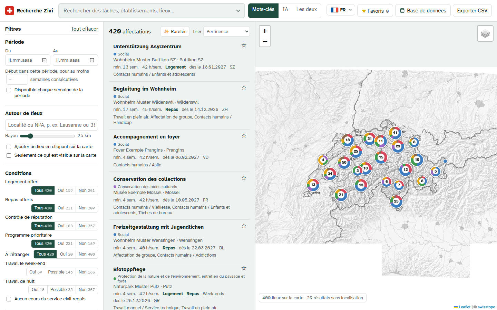

# Zivi search

A local search engine and map for ZiviConnect civil-service assignments
(*cahiers des charges*). Load the JSON export, then filter by every attribute, search the
text, and see every result on a map of Switzerland.



## Quick start (Windows)

You need [uv](https://docs.astral.sh/uv/). Then, in PowerShell or cmd:

```powershell
cd C:\dev\zivi
uv sync
uv run zivi serve
```

Your browser opens at http://127.0.0.1:8765. Click **Load JSON** and pick
`ziviconnect_full_3756.json` (or any export). The first import downloads the Swiss postcode
table once (GeoNames, ~1 MB) to place every assignment on the map; this takes about a minute.
Re-imports reuse the cached locations.

You can also import from the terminal:

```powershell
uv run zivi import "$env:USERPROFILE\Downloads\ziviconnect_full_3756.json"
uv run zivi search "alpage" --near Lausanne --radius 40 --housing
```

## What you can filter

| Filter | Notes |
|---|---|
| Text | Title, tasks, skills, employer, place, courses. Accent-insensitive, prefix matching (`pflege` finds *Pflegeheim*), `"exact phrase"`, `-exclude`, `a OR b` (OR binds tighter than the other words: `alpage chien OR chat` = alpage and one of chien/chat). Hover the search box for a reminder; the ▾ button opens an advanced form with one field per option. Matches are highlighted. |
| Period | Assignments with a start week between two dates; optionally *N weeks in a row* starting in that window, or *available every week* of the period. |
| Around places | Any number of towns or postcodes, each with its own radius, or click the map to add a point. Results are sorted by distance. "Only what is visible on the map" filters to the current map view. |
| Conditions | Housing, meals, reputation check, priority programme, abroad (yes / no / any); weekend and night work (yes / possible / no); no civil-service course required. |
| Duration and hours | Minimum assignment duration (weeks), hours per week. |
| Types of tasks | Any or all of the selected types. |
| Canton, language, sector, working-hours model | Language is guessed from the description (the export has no language field). |

Every filter shows how many results each choice would give. All results, not just the
current page, are drawn on the map, coloured by sector; when zoomed out, nearby assignments
are grouped into pie-chart bubbles split by sector. The sector filter shows each sector's
colour.

**✨ Raretés** (next to the sort menu) puts first the assignments with unusual traits:
values that at most 5 % of all assignments share, such as abroad, a 1-week minimum, night
work or a rare type of task. Each result shows its rare traits with their share; the
detail panel lists them under *Ce qui la rend rare*. Click the button again to go back to
the previous sort. Click a rare trait to show every assignment that shares it; click several
to combine them. The chosen traits sit on top of the list, each with a × to remove it.

Click the star ☆ on any assignment (list, map popup or detail panel) to mark it as a
favourite. **Favoris** in the top bar then shows only your favourites: the list, the map and
the filter counts are all limited to them. Favourites are stored in `data/favorites.json`
and survive re-imports. **Export CSV** downloads the
current results with contact details (opens directly in Excel).

## AI search (optional)

**AI settings** → choose a provider, paste your token, **Build AI index** (≈ 1–2 minutes and
a few cents with OpenAI `text-embedding-3-small` for ~3800 assignments). Then switch the
search mode next to the search box:

- **AI** ranks by meaning, so "working with animals outdoors" also finds *Alp-Pflege* or *Biotoppflege*.
- **Both** combines keyword matches with AI matches.

Works with any OpenAI-compatible embeddings API: OpenAI, Mistral, or a local
[Ollama](https://ollama.com) (`ollama pull nomic-embed-text`, no token needed).
The token is kept only in the local server's memory, never written to disk. The chosen
provider URL and model are saved in `data/ai_settings.json`, so after a restart the matching
index (for example a local Ollama one) is loaded again without opening AI settings. Tick
"Remember the token in this browser" to keep it in your browser's storage instead of
re-entering it after a restart. You can also set it as an environment variable:
`ZIVI_AI_API_KEY`, `ZIVI_AI_BASE_URL`, `ZIVI_AI_MODEL`.

## How it works

```
JSON export ──► converter ──► SQLite store (data/zivi.sqlite)
                 │  normalise fields, detect language        ├─ assignments, task_areas, weeks
                 │  geocode addresses (cached)               ├─ locations (lat/lon, canton)
                 │                                           ├─ FTS5 full-text index
                 └─ keep cached locations + AI vectors       └─ embeddings (optional)
                                    │
                         search engine (in memory, ~4k records)
                                    │
                    FastAPI ──► web UI (Leaflet map, vendored, works offline except tiles)
```

- `src/zivi/converter.py` reads the export (several formats accepted), recognises fields by
  name and prints a report of unknown or missing fields.
- `src/zivi/geocode.py` places addresses: coordinates in the record → GeoNames postcode
  table (offline) → swisstopo search API → OpenStreetMap Nominatim (for abroad).
  Set `ZIVI_OFFLINE=1` to stay offline.
- `src/zivi/search.py` filters, ranks (bm25, cosine similarity, or both fused) and computes
  facet counts.
- `src/zivi/semantic.py` builds and queries the embedding index.

If assignments don't appear on the map, run `uv run zivi doctor <file.json>`; it shows how
the addresses in the file are structured and parsed.

## Development

```powershell
uv run pytest
```

Map tiles: swisstopo (grey or colour) and OpenStreetMap. Fonts and Leaflet are bundled in
`src/zivi/static/vendor` with their licences.
